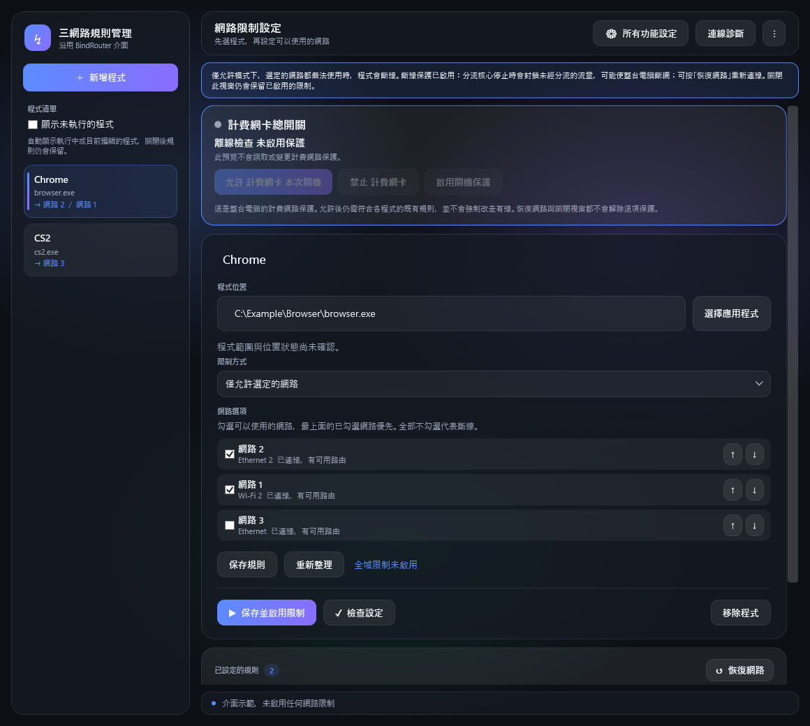

# NetworkRouter

[繁體中文](README.zh-TW.md)

NetworkRouter is a Windows network-routing interface. It manages per-application rules using the bundled Mihomo core and Windows filtering components. Installing it does not turn on routing or the optional paid-network protection. Administrator approval is requested when needed.

*The screenshot is an offline example.*

## Basic use

1. Open NetworkRouter and add a running or installed Windows application.
2. Choose whether to allow or block selected networks, then arrange the network priority as needed.
3. Save and enable the rules. Use **Restore networking** when you want to stop routing and retain the saved rules.

The optional paid-network protection has a separate control and is managed independently.

## Install and remove

Download the Windows x64 setup from the project's GitHub Releases after a release is published, and check its SHA-256 against the published checksum. Run setup and follow its prompts. A clean installation does not change existing rules. To remove the app, use Windows Installed apps. The uninstaller must first restore this tool's routing and remove its optional paid-network protection; if cleanup fails, removal stops and the recovery files remain. Saved user rules are retained. The installer and uninstaller have not yet been validated on a clean Windows machine; this repository is a release candidate, not a finished release.

DNS status and adapter selection indicate configuration and observed routes, not proof of Internet connectivity. Manual diagnostics produce point-in-time results. VPN interfaces do not guarantee control over the cost of their underlying connection.

## Build

See [build/README.md](build/README.md). The source repository excludes binaries, archives, private settings, and logs. The installer must include the fixed Mihomo v1.19.32 binary, its complete corresponding source archive and license notices, both native helpers, and the application. Do not substitute an unverified core.

## Attribution and licensing

The interface incorporates BindRouter v1.2.0 under its MIT license. Mihomo v1.19.32 is GPL-3.0; its complete corresponding upstream source is included with the release package. See [licenses/NOTICE.txt](licenses/NOTICE.txt) and the included third-party licenses. The licensing terms for new project-authored code have not yet been selected by its rights holder; absence of a license does not grant permission to redistribute that code.
