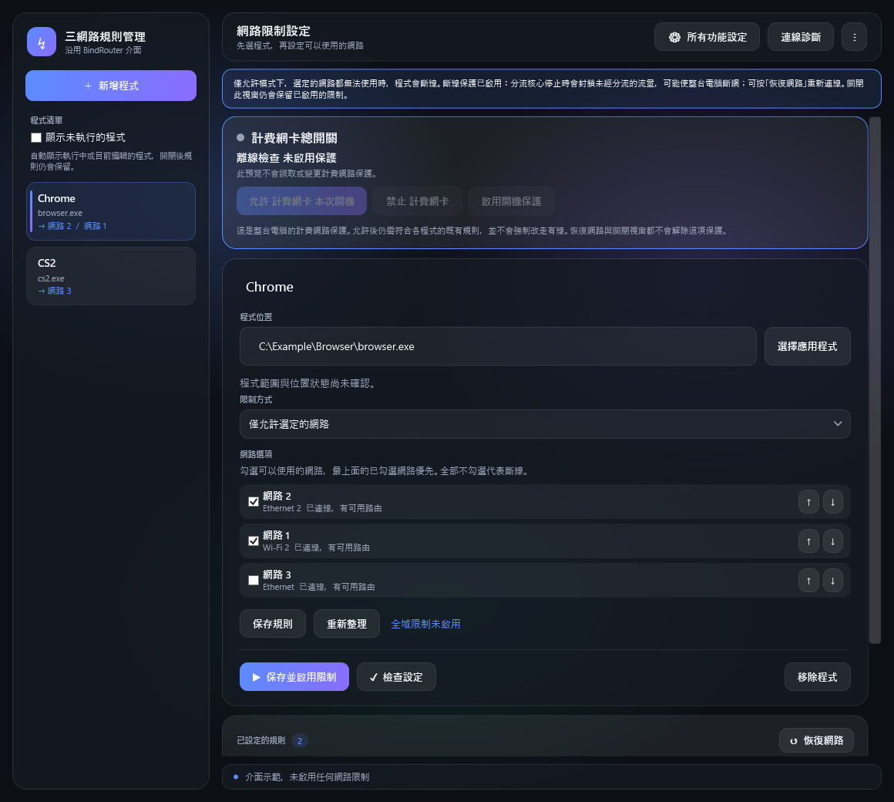

# NetworkRouter

[English](README.md)

NetworkRouter 是 Windows 程式網路規則管理介面，使用隨附的 Mihomo 核心及 Windows 篩選元件。安裝不會自行啟用分流或選用的計費網路保護；需要管理員權限時會要求授權。

*截圖為離線範例。*

## 基本操作

1. 開啟 NetworkRouter，新增正在執行或 Windows 已安裝的應用程式。
2. 選擇允許或禁止指定網路，並依需要調整網路優先順序。
3. 保存並啟用規則；需要停止分流時，使用「恢復網路」保留已保存的規則。

計費網卡額外保護使用獨立開關，需另外管理。

## 安裝與移除

正式發布後，從本專案的 GitHub Releases 下載 Windows x64 安裝程式，並核對發布的 SHA-256。依照安裝畫面操作；全新安裝不會修改既有規則。可透過 Windows「已安裝的應用程式」移除。解除安裝必須先恢復本工具的分流並移除選用的計費網路保護；清理失敗時停止移除並保留恢復檔案。已保存的使用者規則保留。目前安裝及解除安裝尚未在乾淨 Windows 電腦驗證，本儲存庫仍是候選版本。

所顯示的 DNS 狀態與網卡選擇表示設定與偵測到的路由，不代表網際網路一定可連通。手動診斷只反映當次結果；選擇 VPN 介面不保證控制底層網路計費。

## 建置與授權

建置說明見 [build/README.md](build/README.md)。原始碼庫不收錄執行檔、壓縮檔、個人設定或記錄。發行包必須附上固定的 Mihomo v1.19.32、對應完整來源封存與授權、兩個原生工具及應用程式。介面使用 MIT 授權的 BindRouter v1.2.0；Mihomo 為 GPL-3.0，詳見 [第三方聲明](licenses/NOTICE.txt)。新撰寫程式碼的授權尚待權利人決定；未指定授權不代表可自由散布。
